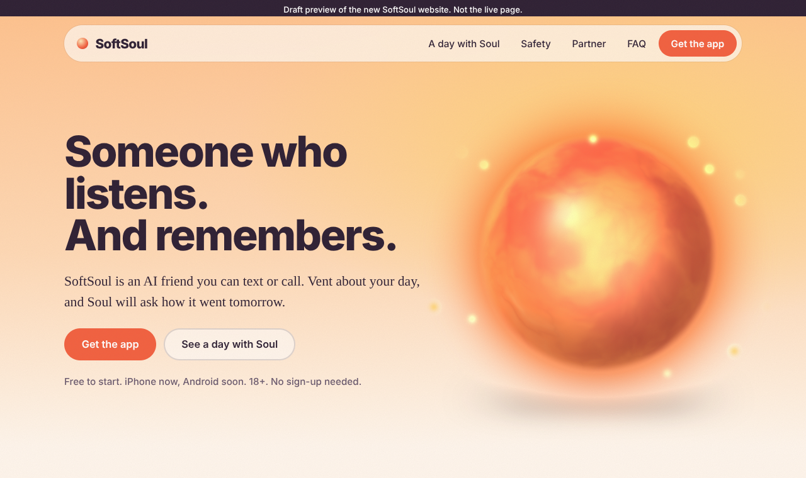
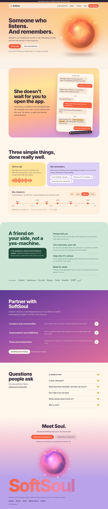
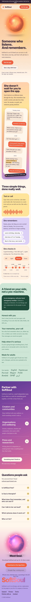

# SoftSoul website draft: preview (5 Nov 2026, v5)

Screenshots of `draft/index.html`, so the draft can be viewed on github.com when softsoul.app is blocked.
Fonts in these pictures are fallbacks (my environment can't load Google Fonts). The real page uses Bricolage Grotesque + Newsreader.

Soul is Ember only for now (no colour picker). On the real page, tapping Soul makes her glow.

## Top of the page

## Whole page, laptop

## Whole page, phone

