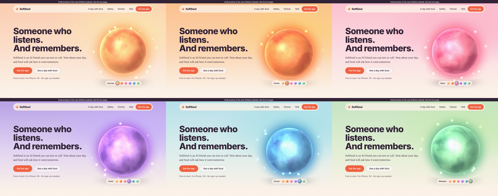

# SoftSoul website draft: preview (5 Nov 2026, v3)

Screenshots of `draft/index.html`, so the draft can be viewed on github.com when softsoul.app is blocked.
Fonts in these pictures are fallbacks (my environment can't load Google Fonts). The real page uses Bricolage Grotesque + Newsreader.

## Soul's colours (tap the orb, or pick a dot under it)
Sunrise, Ember, Rose, Violet, Ocean, Meadow. The sky behind her changes with her colour.

## Whole page, laptop

## Whole page, phone

