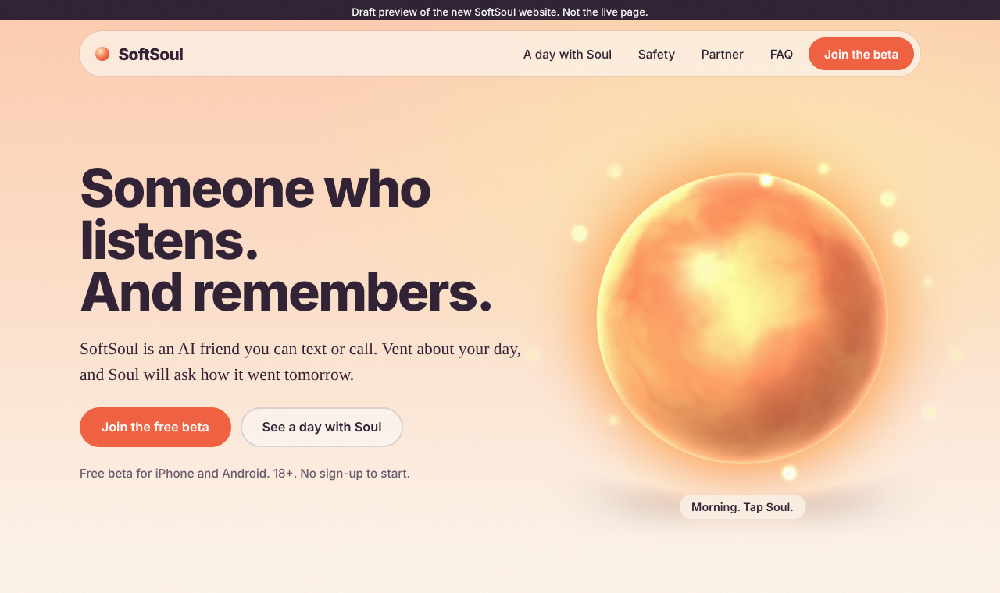
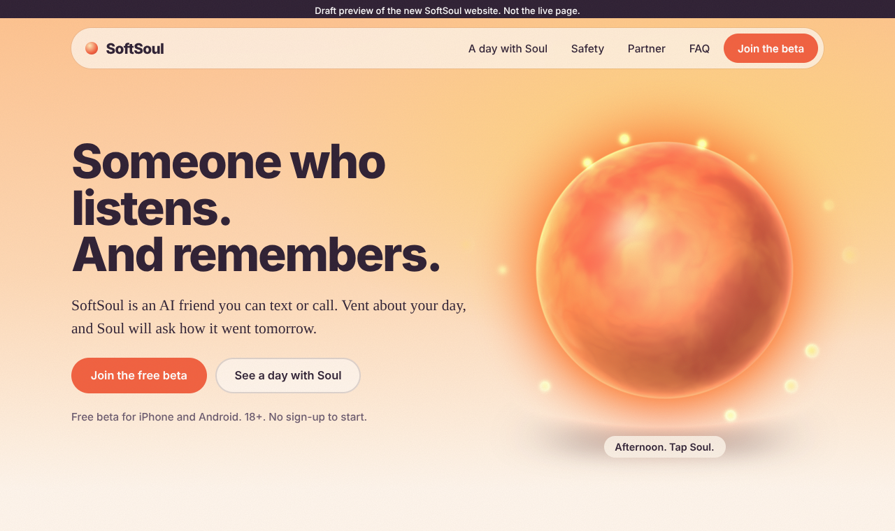
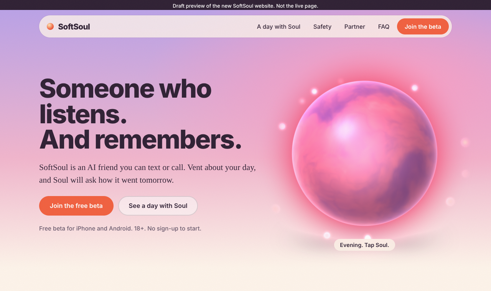

# SoftSoul website draft: preview (5 Nov 2026, v2)

Screenshots of `draft/index.html`, so the draft can be viewed on github.com when softsoul.app is blocked.
Fonts in these pictures are fallbacks (my environment can't load Google Fonts). The real page uses Bricolage Grotesque + Newsreader.

## Soul through the day (tap the orb on the real page)

## Whole page, laptop

## Whole page, phone

